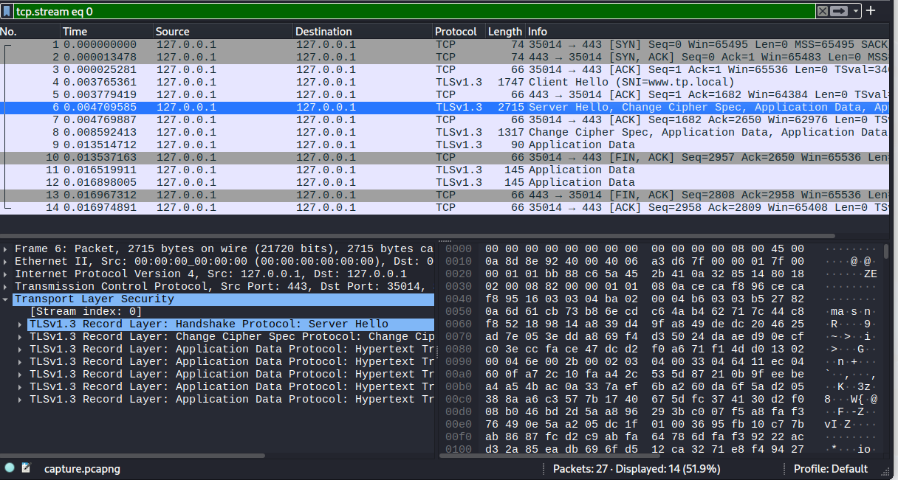
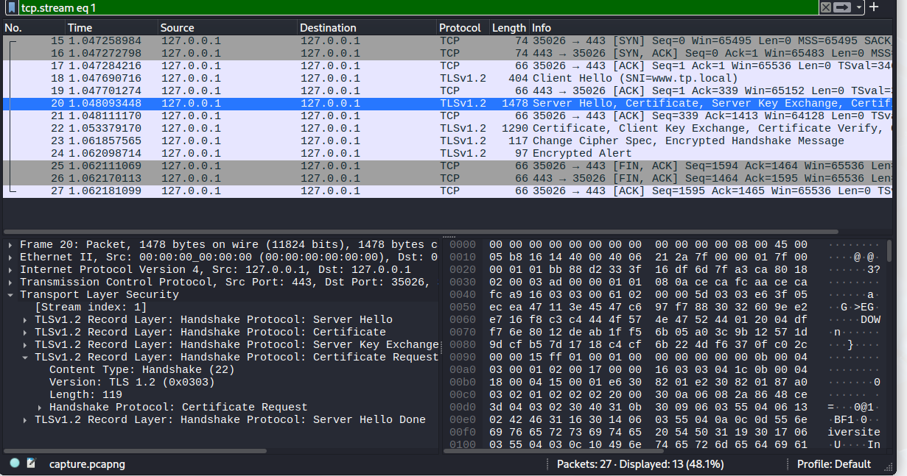

# TP 3 – Déployer un canal sécurisé et gérer les certificats

**Auteur :** NEBIE Bonaventure Elisée  
**Module :** EC1 – Ingénierie de la cryptographie (Dr Zakaria Sawadogo, 2026–2027)  
**Environnement :** Kali Linux (machine virtuelle)

> **Règle de sécurité :** ce dépôt ne contient **aucune clé privée** ni mot de passe (`*.key` est exclu par `.gitignore`). Seuls les certificats publics sont fournis. Les noms utilisés sont des noms de laboratoire (`*.tp.local`), sur la machine locale.

## Description

Déploiement d'un serveur web **nginx** en TLS 1.2 et 1.3 avec **authentification mutuelle** (mTLS) par certificat client, analyse de la poignée de main, supervision des expirations et renouvellement automatique du certificat du serveur. Ce TP réutilise l'infrastructure de clés du TP 2.

## Fichiers

- `tp.conf` : configuration nginx (TLS 1.2 et 1.3, suites TLS 1.2 limitées à ECDHE avec AEAD, tickets de session désactivés, `ssl_verify_client on`, `ssl_crl`, HSTS). À placer dans `/etc/nginx/conf.d/` ; certificats et CRL dans `/etc/nginx/tls/`.
- `surveiller.py` : jours restants des certificats d'un dossier (OK, ALERTE < 30 j, CRITIQUE < 7 j) ; code de sortie 0, 1 ou 2.
- `renouveler.sh` : renouvellement du certificat serveur (nouvelle clé, signature, vérification avant déploiement, archivage, rechargement sans coupure, retour arrière si nginx refuse la configuration).
- `inter.cnf` : diffère de celui du TP 2 par `unique_subject = no`, nécessaire pour émettre un nouveau certificat de même sujet.
- `serveur.crt` (renouvelé), `bob.crt` : certificats publics.
- `captures/` : captures Wireshark de la poignée de main.
- Compte rendu : [../docs/CR_TP3.docx](../docs/CR_TP3.docx)

## Utilisation

```bash
# supervision
python3 surveiller.py <dossier>; echo "code : $?"

# renouvellement (ne fait rien si le certificat est valable plus de 30 jours)
sudo ./renouveler.sh
sudo ./renouveler.sh --force      # test
```

Le renouvellement est planifié chaque jour à 03:00 par un minuteur systemd (`renouveler-tp.timer`).

## Résultats

- Client valide (Bob) : accès accordé. Sans certificat client ou avec le certificat révoqué d'Alice : refus (HTTP 400).
- Poignée de main de Bob : **TLS 1.3**, `TLS_AES_256_GCM_SHA384`, groupe `X25519MLKEM768` (hybride post-quantique), vérification OK.
- TLS 1.1 refusé ; en TLS 1.2, seules trois suites ECDHE avec AEAD sont acceptées (`nmap --script ssl-enum-ciphers`).

### Poignée de main TLS 1.3 : le certificat est chiffré



### Poignée de main TLS 1.2 : le certificat est visible en clair


